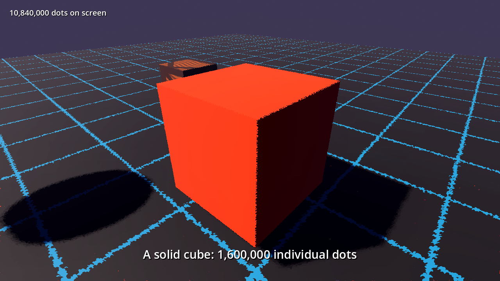
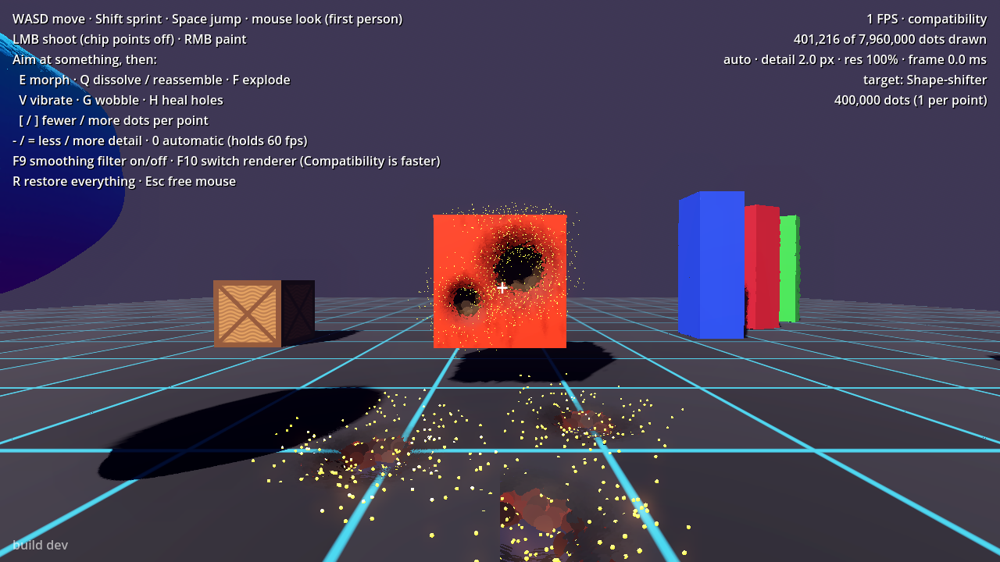
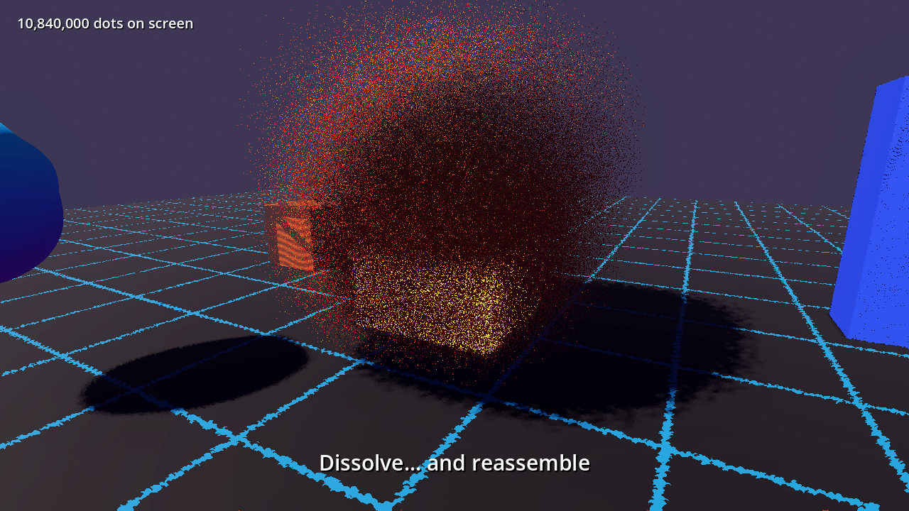

# Point Cloud World

A Godot 4.4+ framework where every model — props, terrain, the player, enemies —
is a huge cloud of tiny points that looks solid but can be edited, animated
and destroyed point by point.

A cube looks like a normal lit cube, but it's 300,000 points. You can make the
points shiver, chip them off with gunfire, dissolve the whole thing into
drifting sparks, or have every point fly over and form a sphere, a torus or 3D
text, changing colour on the way.

| | |
|---|---|
|  |  |
|  | Everything in these shots is dots, drawn as solid surfaces. Top left: the first-person view. Top right: the cube and the floor after a few shots, with dark hole walls and glowing debris beads. Bottom left: a dissolve. Record your own with `tests/demo_video.tscn` (see below). |

## Download (Windows)

Get **PointCloudWorld.exe** from the
[latest release](https://github.com/biosphobia/test7/releases/tag/latest) and
run it. You only download it once. Every push to this repository rebuilds the
game on GitHub Actions, and the exe fetches the new content (a ~100 KB pack)
the next time it starts. If you're offline, it starts the last version it
downloaded. The build's commit is shown in the bottom-left corner.

How it works: `launcher/launcher.gd` is the startup scene. It compares
`version.json` on the release with the version it's running. If GitHub has a
newer build, it downloads `game.pck` and restarts the exe on it with
`--main-pack`. `.github/workflows/build.yml` produces those files.

## Running the demo

Open the folder in **Godot 4.4 or newer** and press Play (`demo/main.tscn`).

The game opens on a singularity: every atom of the scene, the player
included, swarms in a tiny white ball in the middle of the screen. It loosens
and glows as the mouse comes near. Click it and it cracks five times: with
each crack two beams of light break out, the ball jolts and the camera
lurches a quarter of the way closer. The beams go out, the ball holds still
for a moment, and then it explodes with a hard screen shake: every atom is
hurled far out in all directions, then sweeps on up out of the top of the
view as a rising mist. The world is then built from above: first the floor,
one grid square at a time dropping in as a slab, from the far end towards
the viewer; then everything on it, formed by a fine rain of specks; then the
player. The whole intro is seen from straight behind the player's eyes. Only when it all stands do the atoms take on their colours. The
camera then drops into the player's head and hands over control.

| Input | Action |
|---|---|
| WASD / Shift / Space / mouse | move, sprint, jump, look (first person) |
| LMB (hold) | shoot bullets (little clouds of atoms) that knock atoms off whatever you aim at. The grey **stone block** is a different element: its chips fall, bounce and stay on the ground |
| RMB (hold) | paint points with a cycling colour |
| E | morph (the shape-shifter cycles cube → sphere → torus → "POINTS"; anything else turns into a sphere and back) |
| Q | dissolve / reassemble |
| F | explode pulse |
| V / G | toggle vibrate / wobble |
| H | heal: carved-off points fly back into place |
| [ / ] | lower / raise the 3D render resolution (the option for slow GPUs) |
| - / = | less / more detail (bigger / smaller atoms) |
| 0 | automatic detail on / off (off by default: detail never changes by itself) |
| F10 | switch renderer: Compatibility (default, fastest) ↔ Forward+ |
| R | restore everything instantly |
| F9 | smoothing filter on/off (edge-aware blend over the 3D view) |
| Esc | free the mouse (click to recapture) |

The scene holds about 3.5 million stored points, all drawn as beads. Up close
each point splits into many smaller beads, so surfaces stay closed and
smooth however near you get: ground, a morphing cube, a textured crate, monoliths, a jelly orb, the
player and a skinned worm enemy that crawls around. Shoot the worm 15 times and it dissolves, then reassembles.

## How it works

```
PointCloudData  (Resource)     positions, colors, normals, optional bone weights
      │  made by
PointSampler    (static)       mesh → points: area-weighted, takes colour from material
      │  drawn by                 albedo/texture/vertex colours, copies skin weights
PointCloud      (GeometryInstance3D)
      │  uploads data to float textures, one texel per point
point_cloud.gdshader           draws up to `max_amplification` beads per point; each finds its point,
                               applies skinning, morph, effects, debris, ripples and
                               outputs a GL point sized in world units
```

* **Rendering.** One shared batch of 32,768 dummy points (`PRIMITIVE_POINTS`) is
  drawn instanced as many times as needed. Each dot works out its index from
  `INSTANCE_ID` and `VERTEX_ID`, looks up its data and sets `POINT_SIZE` so it
  keeps a constant world size. Memory doesn't grow with the dot count. Dots are
  opaque and lit (or `unshaded`), write depth and cast shadows like normal
  geometry.
* **Everything is beads.** Every dot is a small round bead, at rest and in
  flight. Resting beads overlap and are shaded with the surface's normal, so
  together they read as one continuous surface. For each pixel the fragment
  shader intersects the view ray with the surface plane, so texture, edges,
  lighting and shadows are exact per pixel. Points are spread evenly
  (stratified per triangle plus an R2 low-discrepancy sequence).
* **Smaller beads up close.** As you get nearer, each stored point splits
  into more, smaller beads (up to `max_amplification`, default 32), spread
  over its patch of surface with a scrambled Halton sequence. Beads stay
  about 2 px apart on screen at any distance, so you never see individual
  beads or gaps, even with your face against a wall. Unneeded bead slots are
  dropped at the top of the vertex shader, so far objects cost nothing extra.
* **Smooth shading.** Each point stores its surface's curvature tensor,
  fitted from the source mesh's vertex normals. The shader bends the normal
  across each disc with it, which reproduces the mesh's interpolated normals,
  so lighting is continuous across dots.
* **Sharp edges and detail.** Resting dots are trimmed at the cloud's bounding
  box, so box edges are crisp. Fine colour detail can come from
  `surface_texture`, sampled per pixel (triplanar, mip level from the exact
  pixel footprint) and multiplied with the dot colours. The demo floor grid
  and crate use it. Dot colour alpha masks it, so interior points stay plain.
* **More beads for free.** The extra beads exist only on the GPU. Each one
  has its own seed, so effects and debris act on each bead separately, while
  sampling time, CPU memory and carve cost stay the same as for the stored
  points.
* **Effects cost no CPU.** Vibrate, wobble, explode, dissolve, morph and ripples
  are shader uniforms. Every point gets a stable random seed from a hash of its
  index, which is what makes the motion look per-point.
* **Destruction is per point, with no stalls.** `carve()` hands the shader a
  carve sphere: the shader detaches the dots inside it, flies them
  ballistically as small lit beads and fades them out, and turns the dots
  around it into the hole's wall (normals facing into the hole, darkened
  like a cavity). A worker thread later folds batches of carves into a state
  texture with exactly the same maths (same hashes), so nothing changes on
  screen. `heal()` pulls the debris back.
* **Morphs never block.** `morph_to()` prepares the target on a worker thread
  (generating it too, if you pass a Callable), uploads its textures over a
  few frames and then starts. Targets stay cached on the GPU, and finishing a
  morph swaps textures instead of re-uploading. `prepare_morph_target()`
  warms the cache ahead of time.
* **The same atoms, all the time.** A resting object and an exploding one
  are drawn from the very same atoms at the same on-screen size (about 2.6 px
  at the default `lod_spacing_px` of 1.25). Effects only move them: nothing
  is spawned, resized or swapped when an effect starts or ends, so there is
  no visible transition. Lighting shifts gradually with distance from an
  atom's place, from surface-lit to a free, partly glowing speck. Interior
  points show only once they've moved or as hole walls.
* **Any model.** Open or thin-shell meshes (a vase, a leaf) are detected
  when sampled (`PointCloudData.closed`) and drawn and lit from both sides.
  Morph targets with fewer points are spread out to cover evenly.
  `tests/custom_model_test.tscn` exercises a hand-built open mesh and a
  multi-mesh figure.
* **Elements.** `PointCloud.element` (a `PointElement` resource) says what a
  cloud's atoms are made of, i.e. how they behave once knocked loose:
  gravity, bounce, friction, air drag, whether they land and stay, glow,
  hardness. Presets: `ember()` (the default: glowing sparks that fade),
  `stone()`, `rubber()`, `dust()`. The physics is a closed-form path per
  atom in the vertex shader (launch, fall, bounces off the ground at
  `floor_y`, slide to rest), so loose atoms cost the same as resting ones
  and nothing is simulated on the CPU. Atoms collide with the ground, not
  with each other or other objects. `carve(..., kick)` throws the chips in
  a direction, e.g. back along a bullet's path.
* **Singularity.** `PointCloud.gather` (1 → 0) packs a cloud's atoms into a
  small swarming ball at `gather_center`, then releases them in three acts:
  an explosion that hurls every atom far out (`gather_burst`), after which
  it rises to a staging point above the view; a build in which each atom
  drops into its place from there, a speck until it lands (`gather_tile`
  makes a floor arrive square by square as slabs); and finally colour. `gather_window` gives
  a cloud its share of the build (floor first, player last); within it the
  build starts farthest from `gather_eye` (`gather_reach`).
  `gather_radius`, `gather_agitate` and `gather_heat` shape the ball. The
  demo intro drives it on every cloud at once.
* **Swirls and swarms.** Atoms are carried by a smooth flow field, so
  neighbours move together: explosions twist and break into streams, and
  morphs first come apart into a drifting cloud, then swarm into the new
  shape clump by clump (`morph_swarm`,
  `explode_swirl`, `explode_turbulence` shader parameters).
* **Animation.** Skinned meshes keep their bone indices and weights per point,
  and the bone matrices are uploaded each frame from the `Skeleton3D`. So an
  imported character with an `AnimationPlayer` animates as points without any
  extra work.
* **Solid interiors.** With `Fill.SOLID` or `Fill.SHELL`, part of the points go
  inside the model. When you chip at it there is material underneath (in the
  demo the cube has a hot glowing core).

## Using it in your game

```gdscript
# From primitives
var cube := PointCloud.new()
cube.data = PointSampler.box(Vector3(2, 2, 2), 300_000, {"color": Color.ORANGE})
add_child(cube)

# From any mesh / imported model (keeps textures and skeleton animation)
var character := load("res://enemy.glb").instantiate()
add_child(character)
PointCloud.convert_scene(character, 20000.0)   # points per m² of surface

# Effects — all animatable with Tweens/AnimationPlayer
cube.vibrate_amplitude = 0.02
cube.wobble_amplitude = 0.05
cube.dissolve_out(3.0)                 # then cube.reassemble(2.0)
cube.explode_pulse()
cube.morph_to(PointSampler.sphere(1.2, 1000), 2.0)   # counts matched; never blocks
cube.prepare_morph_target(other_shape)  # optional: warm up so the morph starts instantly
cube.carve(hit_position, 0.4)          # chip a hole; points fly off
cube.impact(hit_position)              # ripple through the surface
cube.paint(hit_position, 0.5, Color.RED)
cube.heal(1.5)
cube.max_amplification = 16            # cap on beads per point up close (cost vs. close-up quality)
cube.surface_texture = load("res://wood.png")   # per-pixel detail on top of dot colours
cube.texture_tile = Vector3(2, 2, 2)

# Edit individual points from code
var p := cube.data.positions
for i in p.size():
	p[i].y += sin(p[i].x * 4.0) * 0.1
cube.data.positions = p
cube.commit()
```

You can also add a `PointCloud` node in the editor, set **Source Mesh**, and
press **Sample source mesh**. Set **Source Bake Path** to a `.res` file so large
clouds are saved in binary form instead of inside the scene. Effect sliders
preview live in the editor.

### Writing your own point effects

Edit `custom_effect()` in `pointcloud/point_cloud.gdshader`. If you want
different effects on different objects, copy the shader and assign the copy to
`PointCloud.shader_override`. The function receives each dot's position,
normal, colour, size, rest position, random seed, its stored point's index,
which of that point's dots it is (`sub`), and the time. Anything
you can write in GLSL runs on every point every frame.

## Files

| Path | What |
|---|---|
| `pointcloud/point_cloud.gd` | `PointCloud` node: upload, effects API, carving, skinning |
| `pointcloud/point_cloud.gdshader` | the per-point renderer and effects |
| `pointcloud/point_sampler.gd` | mesh → points, primitive shapes, 3D text, morph matching |
| `pointcloud/point_cloud_data.gd` | `PointCloudData` resource |
| `pointcloud/point_grid.gd` | spatial grid for carve/paint queries |
| `demo/` | the playable sandbox (player, worm enemy, props) |
| `tests/` | `smoke_test.tscn` / `demo_capture.tscn` / `closeup_test.tscn` render screenshots headlessly; `demo_video.tscn` is a scripted showcase for Movie Maker |

## Recording a video

```sh
godot --path . --write-movie out.avi --fixed-fps 30 res://tests/demo_video.tscn
```

Movie Maker renders at a fixed frame rate however slow the machine is. The
point clouds' clock follows game time (`PointCloud.now()`), so all effects
stay in sync in the recording.

## Performance

The demo targets 60 fps on modest GPUs. It holds about 3.5 million stored
points but draws only around 0.5–1 million dots per frame, and auto quality
trades detail to hold the target. The main techniques:

* **Level of detail.** Points are stored in *progressive* order: every prefix
  of the list is evenly spread over the surface (bit-reversed strata plus
  per-triangle R2 sequences). Each frame a cloud estimates how big it is on
  screen and draws only the prefix it needs for `PointCloud.lod_spacing_px`
  (default 2 px) between points, enlarging them to keep the surface closed.
  It's a single `MultiMesh.visible_instance_count` change, with no CPU work
  per point.
* **Interior points only when exposed.** Points are stored as
  `[surface | interior]`; the interior fill is drawn only while something
  reveals it (carving, dissolve, explode, morph).
* **Back-facing dots are dropped** in the vertex shader (and for shadows,
  dots facing away from the light).
* **Cheap shadows.** A cloud doesn't cast shadows itself; a hidden copy with a
  quarter of the dots does, and the demo sun uses 2 cascades instead of 4.
* **Early depth test.** The default shader keeps each dot's flat depth, so the
  depth prepass rejects hidden pixels before they're shaded. Set
  `PointCloud.exact_depth = true` for the slower variant that writes exact
  per-pixel depth.
* **Smaller data.** 8-bit colours and half-float normals and curvature; the
  debris and ripple lookups are skipped while nothing is carved or hit.
* **Tiled terrain.** The demo ground is split into tiles, so level of detail
  and culling work per tile. The floor is beads too, but with sparser points
  (`lod_spacing_scale`), less overlap (`bead_overlap`) and no extra beads up
  close (`max_amplification = 1`): you rarely look at it from a few
  centimetres. (`PointCloud.flat_proxy` still exists for scenes that want to
  draw an intact flat cloud as a single plane, but the demo doesn't use it.)
* **Shadow maps.** Shadow-pass dots are plain squares sized to close gaps
  and pushed away from the light by about their radius, so shadows are solid
  and surfaces don't shadow themselves.
* **Lightweight renderer by default.** The project uses Godot's Compatibility
  (OpenGL) renderer, which is much cheaper on weak GPUs; it did a demo frame
  about 3.6× faster than Forward+ in testing. Press **F10** in game to switch
  to Forward+ (nicer, heavier). The launcher restarts the game with the
  chosen renderer and remembers it.
* **Capped render resolution.** Atoms are sized in pixels, so their number
  grows with resolution. `PointCloudQuality` renders the 3D view at most
  `max_render_height` (800) pixels high and upscales it, so a 1080p or 1440p
  screen costs about the same as 720p and looks the same. `resolution_scale`
  (`[` / `]` in the demo) lowers it further on slow GPUs.
* **Detail is manual by default.** `PointCloud.lod_spacing_px` stays where
  you set it (`-` / `=` in the demo). Automatic detail
  (`PointCloudQuality.enabled`, `0` in the demo) is opt-in: it adjusts
  detail and resolution to hold `target_fps`.

Measured with CPU-only software rendering (so only the ratio means
anything), a demo frame went from 9.6 s to about 0.45 s at the same detail,
roughly 20× less work per frame, before auto quality does anything. Drawing
the floor as beads instead of a flat plane made that frame about 1.5× slower
than with the proxy (0.30 s); auto quality absorbs it on a real GPU.

`tests/hitch_test.tscn` measures how long gameplay actions block the main
thread (morphing, shooting); they are all well under a millisecond.

### Limits

* Startup samples every model in GDScript (about 1.5 µs per point), so the
  demo takes 10–15 s to build. Bake large clouds to `.res` files.
* Collision uses ordinary `CollisionShape3D`s and doesn't follow carved holes.
* Debris and dissolve are in the cloud's local space, so debris moves with the
  object.
* If you sort points yourself (e.g. `PointSampler.sort_spatially`), level of
  detail will thin them unevenly; use `match_order` for morph targets.
